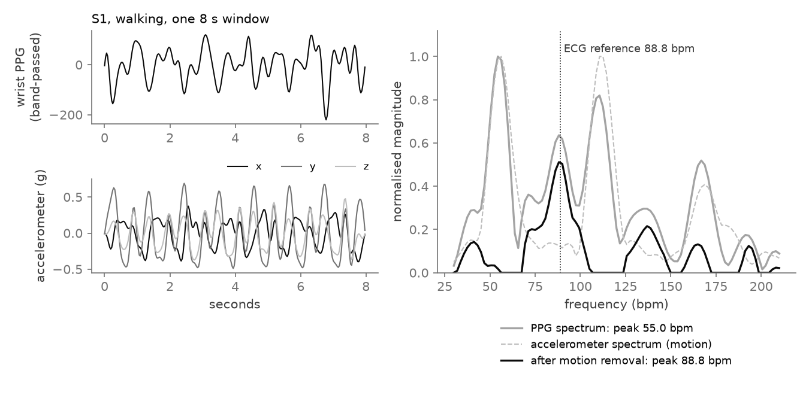
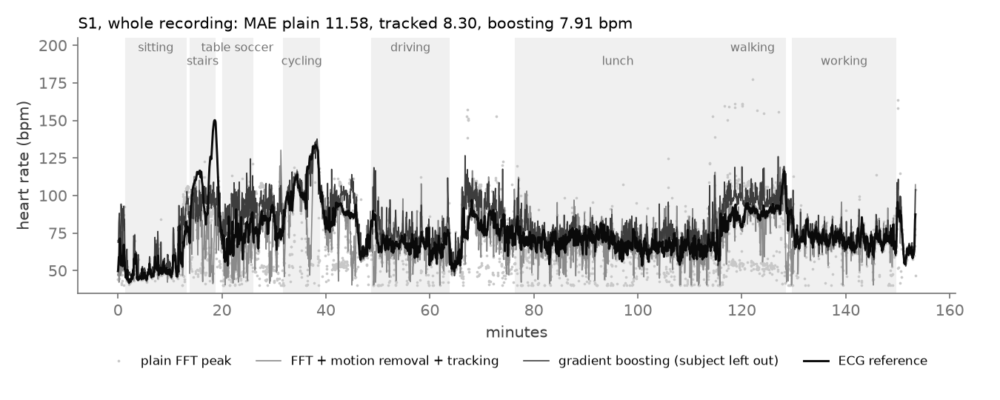
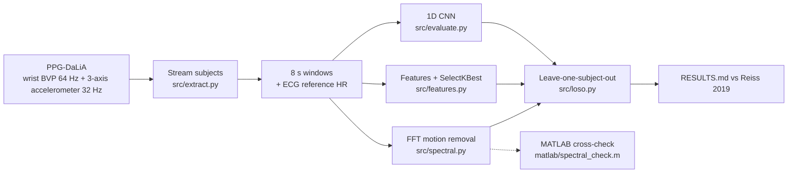

<div align="center">

# Wrist PPG Heart Rate Under Motion

**Heart rate from a wrist optical sensor during daily life, when arm motion swamps the pulse.**

An FFT method that uses the accelerometer to remove motion, plus gradient boosting and a small 1D CNN, all scored
leave-one-subject-out on the public PPG-DaLiA dataset and compared with the published Deep PPG results.

[**Project page →**](https://dheepakkaran.github.io/wearable-ppg-motion-artifacts/) · [Results](RESULTS.md) · [Data card](DATA_QUALITY.md)


-737373)


<a href="https://dheepakkaran.github.io/wearable-ppg-motion-artifacts/#overview"></a>

<sub>35-second overview (silent preview). <a href="https://dheepakkaran.github.io/wearable-ppg-motion-artifacts/#overview">Watch it with sound on the project page →</a></sub>

</div>

> **Research project on public data.** Not a medical device, no clinical claim. Independent project.

---

## Why this exists

Smartwatches read heart rate by shining light into the wrist (photoplethysmography, PPG). At rest this works well.
When the arm swings, the motion moves blood and the sensor too, and the motion rhythm often shows up in the
spectrum louder than the pulse. An arm swing of about 55 cycles per minute can then be read as a heart rate of 55 bpm.

The watch also has an accelerometer that sees the motion directly. This repo measures how much that helps:
a plain FFT baseline, the same FFT with the accelerometer spectrum subtracted, the same plus tracking across windows,
and two learned models, each tested on subjects it never saw, against the published numbers on the same data.

## Results

15 subjects · 64,697 windows (8 s, 2 s shift) · leave-one-subject-out · MAE in bpm, mean of subjects ± std
(`results/metrics.json` → [RESULTS.md](RESULTS.md)).

| Method | MAE (bpm) | Worst activity |
|---|---|---|
| Plain FFT peak (baseline) | 17.24 ± 7.84 | stairs 36.16 |
| FFT + accelerometer motion removal | 16.37 ± 5.79 | stairs 28.27 |
| FFT + motion removal + peak tracking | 12.15 ± 5.82 | cycling 24.80 |
| **Gradient boosting, 20 selected features** | **8.29 ± 3.88** | stairs 15.04 |
| 1D CNN on spectra (3 epochs, 1 seed) | 12.43 ± 5.94 | cycling 25.72 |
| *Published: Deep PPG CNN ensemble (Reiss 2019)* | *7.65 ± 4.2* | *stairs 16.98* |
| *Published: SpaMaPlus (Reiss 2019)* | *11.06 ± 4.8* | *stairs 25.42* |

- **Motion removal with tracking cuts error by 29.5%** against the plain FFT baseline (17.24 → 12.15).
- **Motion removal alone hurts at rest.** Sitting goes from 2.73 to 4.06 bpm: subtracting a near-silent accelerometer spectrum removes some of the real pulse peak.
- **Gradient boosting is the best model here**, 0.64 bpm behind the published CNN ensemble. It mostly learns when to trust which FFT estimate, given how much the wrist moves.
- **The CNN is undertrained** (3 epochs, one seed) and is shown as is.
- **Rough comparison, not a ranking.** Published values were read from the paper's tables; setup differences are listed in [RESULTS.md](RESULTS.md). No significance test was run.
- **MATLAB check.** The FFT motion-removal core was re-written in MATLAB and run in MATLAB R2026b: it matches Python to **1e-10 bpm** on 20 windows ([`results/matlab_online_check.json`](results/matlab_online_check.json)). GNU Octave 10.3.0 gives the same.

<details>
<summary>MAE per activity (bpm)</summary>

| Activity | Plain FFT | FFT + motion removal | + tracking | Gradient boosting | CNN |
|---|---|---|---|---|---|
| sitting | 2.73 | 4.06 | 2.85 | 4.23 | 11.06 |
| working | 7.99 | 9.13 | 6.01 | 4.84 | 8.42 |
| driving | 11.76 | 13.56 | 8.71 | 6.66 | 9.66 |
| lunch | 12.57 | 13.21 | 8.28 | 5.94 | 8.97 |
| transient | 21.13 | 19.68 | 14.27 | 9.86 | 12.30 |
| walking | 27.13 | 23.14 | 16.34 | 10.41 | 12.12 |
| cycling | 27.90 | 23.57 | 24.80 | 12.57 | 25.72 |
| table soccer | 27.93 | 26.49 | 23.65 | 13.22 | 15.44 |
| stairs | 36.16 | 28.27 | 24.28 | 15.04 | 23.72 |

Source: [`results/mae_by_activity.csv`](results/mae_by_activity.csv).
</details>

### Demo: one walking window, and one whole recording



*Subject S1, window 3543 (walking), drawn from the local PPG-DaLiA windows with the repo's own `src/spectral.py`.
The arm swing puts the biggest PPG peak at 55.0 bpm; subtracting the accelerometer spectrum leaves 88.8 bpm against an
ECG reference of 88.8. This window was picked as a clear example; on average, motion removal alone helps only a little.*



*All 4,603 windows of S1 from the committed `results/predictions.csv.gz`, with the protocol activities shaded.
The plain FFT (light dots) drops to the arm-swing rate during walking and stairs; the gradient boosting model, trained
without S1, follows the reference most closely. Both figures: `scripts/make_demo_figures.py`.*

## How it works



1. **Streaming.** Each subject pickle is 0.8–1.6 GB, mostly 700 Hz chest signals. A lean unpickler skips them, so peak RAM stays around 240 MB.
2. **Spectral method.** Band-pass 0.5–4 Hz, Hann-windowed zero-padded FFT of the PPG and each accelerometer axis. The motion spectrum is subtracted, weighted by how much the wrist moves. Heart rate = interpolated spectral peak, with causal tracking within ±15 bpm of the previous window.
3. **Models.** Gradient boosting (scikit-learn) on 20 of 91 features picked by `SelectKBest`, refit inside each fold. A PyTorch 1D CNN (22,785 parameters) on the PPG, motion-removed PPG and accelerometer spectra.
4. **Validation.** Leave-one-subject-out for every method; a test and an assert make sure no subject is in train and test at once.

## Design decisions

| Decision | Why |
|---|---|
| **Split by subject, never by window** | windows overlap by 75%; a window split would leak neighbours into the test set |
| **Plain FFT baseline kept in every table** | shows what the accelerometer and tracking add on their own |
| **Motion removal weighted by wrist motion** | at rest there is nothing to remove; full subtraction would eat the pulse peak (sitting still gets worse) |
| **Causal tracking only** | a watch cannot look ahead; tracking uses past windows and no labels |
| **Gradient boosting on FFT estimates + motion features** | cheap to train on CPU and easy to inspect: the 18 features picked in every fold are the FFT estimates, spectral peaks and motion strength |
| **Published numbers stored with their source** | `references/published_reiss2019.json` quotes the paper's tables, so the comparison can be checked |
| **Independent MATLAB re-implementation** | a second implementation catches FFT and peak-interpolation bugs |

## What broke / limits found

1. **Accelerometer units.** The dataset readme says 1/64 g, but that applies to the raw CSV; in the pickles the data is already in g. The first extraction divided by 64 again; `src/extract.py` was fixed and `src/features.py` corrects older files.
2. **Spectral settings were hand-picked** on S1, S2 and S6 (a 2 × 2 grid), not nested, so the FFT rows are slightly optimistic for those subjects.
3. **The first CNN run was too slow** (99 s per fold). It was cut to 3 epochs on every second training window, one seed: 400 s in total. It stays weaker than gradient boosting, especially on cycling (25.72) and sitting (11.06).
4. **S5 is the worst subject for every method** (plain FFT 40.16, boosting 19.94); the paper also reports S5 as its worst session.
5. **Cycling defeats the spectral tracker** (27.90 → 24.80) although the wrist moves a lot; why has not been investigated yet.
6. **MATLAB's `filtfilt` needs a toolbox**, so the band-pass runs in Python before export; the MATLAB check covers the FFT, window, normalisation, motion subtraction and peak interpolation.

## Run it

```bash
git clone https://github.com/dheepakkaran/wearable-ppg-motion-artifacts.git
cd wearable-ppg-motion-artifacts
make reproduce   # env → download PPG-DaLiA (2.7 GB) → windows → tests → features → evaluate → Octave check
make test        # 5 pytest checks: FFT motion removal on a synthetic pulse, no subject in train and test
uv run --with matplotlib --with numpy --with scipy --with pandas python scripts/make_demo_figures.py
```

- **Needs:** [uv](https://docs.astral.sh/uv/) and about 3 GB of disk.
- **Optional:** [pixi](https://pixi.sh) for the MATLAB-syntax check under GNU Octave.
- **MATLAB:** `python scripts/matlab_export.py`, run `matlab/spectral_check.m`, then `python scripts/matlab_compare.py`.

## Repo map

| Path | What |
|---|---|
| `src/extract.py` | lean streaming unpickler → 8 s windows per subject |
| `src/spectral.py` | band-pass, FFT, motion removal, peak interpolation, tracking |
| `src/features.py` · `build_features.py` | 91 spectral and motion features per window |
| `src/loso.py` · `evaluate.py` | leave-one-subject-out splits · every method → `results/metrics.json` |
| `scripts/` | `fetch` · `data_card` · `matlab_export` · `matlab_compare` · `results_tables` · `make_demo_figures` |
| `matlab/` | `spectral_check.m` · `nspec.m` · `peak_bpm.m` (MATLAB / Octave) |
| `tests/` | `test_spectral.py` · `test_loso.py` |
| `references/published_reiss2019.json` | published numbers, quoted with table numbers |
| `results/` | metrics, MAE by activity and subject, per-window predictions, MATLAB/Octave check files |
| `RESULTS.md` · `DATA_QUALITY.md` | all numbers and setup differences · data card |
| `docs/index.html` | the project page (GitHub Pages) |

## Limits

- **Hand-picked spectral settings**, not nested (see above).
- **Short CNN training** on CPU, untuned, one seed.
- **Hardest cases stay hard.** Stairs, cycling and table soccer are the worst activities for every method.
- **No significance test**; differences of about 1 bpm between rows should not be read as real.

## Next

Nested tuning of the spectral settings · longer CNN training and a small ensemble · a per-window signal-quality flag
so a watch can say "no reading" instead of a wrong one · a look at why tracking fails on cycling.

## Data and citation

- **PPG-DaLiA**: Reiss A, Indlekofer I, Schmidt P. UCI Machine Learning Repository, 2019. doi:10.24432/C53890. Licensed under [CC BY 4.0](https://creativecommons.org/licenses/by/4.0/).
- Reiss A, Indlekofer I, Schmidt P, Van Laerhoven K. *Deep PPG: Large-Scale Heart Rate Estimation with Convolutional Neural Networks.* Sensors 19(14):3079, 2019. doi:10.3390/s19143079.

## License

Code: [MIT](LICENSE) © 2026 Dheepak Karan Elumalai Santhakumari. Data: see above.
