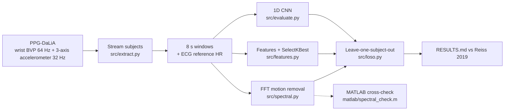

# Wearable PPG Heart Rate Algorithm Under Motion Noise

Heart rate from a **wrist PPG** (optical pulse) sensor during daily life, where arm motion swamps the pulse signal.

This repo builds two approaches on the public **PPG-DaLiA** dataset and tests both leave-one-subject-out against published results:
- an FFT spectral method that uses the accelerometer to remove motion
- machine learning models (gradient boosting with feature selection, and a 1D CNN)

> Research project on public data. Not a medical device, no clinical claim.

   -lightgrey)

---

## Key results

15 subjects · 64,697 windows (8 s, 2 s shift) · leave-one-subject-out · MAE in bpm (mean of subjects ± std).

| Method | MAE | Worst activity |
|---|---|---|
| Plain FFT peak (baseline) | 17.24 ± 7.84 | stairs 36.16 |
| FFT + accelerometer motion removal | 16.37 ± 5.79 | stairs 28.27 |
| FFT + motion removal + peak tracking | 12.15 ± 5.82 | cycling 24.80 |
| **Gradient boosting, 20 selected features** | **8.29 ± 3.88** | stairs 15.04 |
| 1D CNN on spectra (3 epochs, 1 seed) | 12.43 ± 5.94 | cycling 25.72 |
| *Published: Deep PPG CNN ensemble (Reiss 2019)* | *7.65 ± 4.2* | *stairs 16.98* |
| *Published: SpaMaPlus (Reiss 2019)* | *11.06 ± 4.8* | *stairs 25.42* |

What this shows:
- **Motion removal with tracking helps.** It cuts error by **29.5%** against the plain FFT baseline. Without tracking it helps on stairs, cycling and walking, but it hurts at rest (sitting goes from 2.73 to 4.06).
- **Gradient boosting is the best model here.** It gets within 0.64 bpm of the published CNN ensemble.
- **The CNN is undertrained.** It ran 3 epochs on one seed, and it is shown as is.
- **The setups differ.** Published values were checked against the paper's tables (PMC6679242), and the differences in setup are listed in [`RESULTS.md`](RESULTS.md). No significance test was run.

**MATLAB check.** The FFT motion-removal core was re-implemented in MATLAB and run in MATLAB R2026b. It matches Python to **1e-10 bpm** on 20 windows ([`results/matlab_online_check.json`](results/matlab_online_check.json)).

<details>
<summary>MAE per activity (bpm)</summary>

| Activity | Plain FFT | FFT + motion removal | + tracking | Gradient boosting | CNN |
|---|---|---|---|---|---|
| sitting | 2.73 | 4.06 | 2.85 | 4.23 | 11.06 |
| working | 7.99 | 9.13 | 6.01 | 4.84 | 8.42 |
| driving | 11.76 | 13.56 | 8.71 | 6.66 | 9.66 |
| lunch | 12.57 | 13.21 | 8.28 | 5.94 | 8.97 |
| transient | 21.13 | 19.68 | 14.27 | 9.86 | 12.30 |
| walking | 27.13 | 23.14 | 16.34 | 10.41 | 12.12 |
| cycling | 27.90 | 23.57 | 24.80 | 12.57 | 25.72 |
| table soccer | 27.93 | 26.49 | 23.65 | 13.22 | 15.44 |
| stairs | 36.16 | 28.27 | 24.28 | 15.04 | 23.72 |

Source: [`results/mae_by_activity.csv`](results/mae_by_activity.csv).
</details>

---

## How it works



| Step | What happens |
|---|---|
| **Streaming** | Each subject pickle is 0.8–1.6 GB. A lean unpickler skips the 700 Hz chest channels, which keeps peak RAM around 240 MB. |
| **Spectral method** | Band-pass 0.5–4 Hz, then a Hann-windowed, zero-padded FFT of the PPG and each accelerometer axis. The motion spectrum is subtracted, weighted by how much the wrist moves. The heart rate comes from an interpolated spectral peak, with causal tracking across windows. |
| **Models** | Gradient boosting (scikit-learn) after `SelectKBest` picks 20 of 91 features, refit inside each fold. A PyTorch 1D CNN with 22,785 parameters runs on the PPG, motion-removed PPG and accelerometer spectra. |
| **Validation** | Leave-one-subject-out for every method. A test and an assert make sure no subject is in train and test at once. |

---

## Quick start

```bash
git clone https://github.com/dheepakkaran/wearable-ppg-motion-artifacts.git
cd wearable-ppg-motion-artifacts
make reproduce   # env → download PPG-DaLiA (2.7 GB) → windows → tests → features → evaluate → MATLAB-syntax check
```

- **Needs:** [uv](https://docs.astral.sh/uv/) and about 3 GB of disk.
- **Optional:** [pixi](https://pixi.sh) to run the MATLAB-syntax check under GNU Octave.
- **MATLAB:** run `matlab/spectral_check.m` after `python scripts/matlab_export.py`, then `python scripts/matlab_compare.py`.

```bash
make test        # pytest: FFT motion removal on a synthetic pulse, no subject in both train and test
```

---

## Repository layout

```
├── src/            extract.py · spectral.py · features.py · loso.py · evaluate.py
├── scripts/        fetch · data_card · matlab_export · matlab_compare · results_tables
├── matlab/         spectral_check.m · nspec.m · peak_bpm.m (MATLAB / Octave)
├── tests/          test_spectral.py · test_loso.py
├── references/     published_reiss2019.json (published numbers, quoted)
├── results/        metrics.json · MAE by activity / subject · predictions · MATLAB check files
├── RESULTS.md      all numbers, setup differences, caveats
└── DATA_QUALITY.md data card: subjects, windows, activities
```

---

## Limitations

- **Hand-picked spectral settings.** They were chosen on 3 subjects (S1, S2, S6) without nested tuning, so the FFT rows are slightly optimistic for those subjects.
- **Short CNN training.** The CNN was trained briefly on CPU and is not tuned.
- **Hardest cases.** Wrist PPG during stairs, cycling and table soccer stays hard for every method.

## Data and citation

- **PPG-DaLiA**: Reiss A, Indlekofer I, Schmidt P. UCI Machine Learning Repository, 2019. doi:10.24432/C53890. Licensed under [CC BY 4.0](https://creativecommons.org/licenses/by/4.0/).
- Reiss A, Indlekofer I, Schmidt P, Van Laerhoven K. *Deep PPG: Large-Scale Heart Rate Estimation with Convolutional Neural Networks.* Sensors 19(14):3079, 2019. doi:10.3390/s19143079.

## License

Code: [MIT](LICENSE) © 2026 Dheepak Karan. Data: see above.
